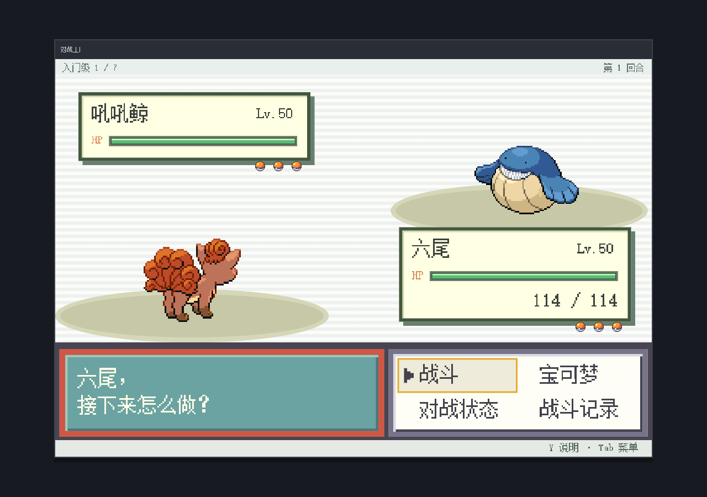
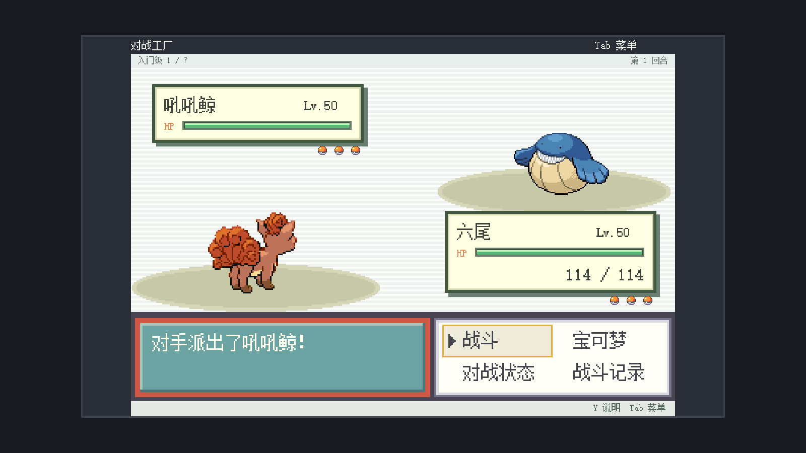

# 对战工厂 · Battle Factory

宝可梦同人游戏：从六只候选中租借三只，进行 50 级、3 对 3 单打，战后交换队员，挑战七连胜。包含 332 种宝可梦，分为入门、标准、精英和大师四个级别；招式、特性与道具在租借时生成。

招式、特性、道具、属性相性与能力值以第九世代《朱／紫》回合制单打为基准；保留的旧招式采用最后可用的回合制效果，详见 [规则核查](docs/modern-rules.md)。交换时可直接查看对方完整资料。当前提供单人七连战，不含联网对战和跨会话存档。



## 选择版本

| 版本 | 用途 | 目录 |
| --- | --- | --- |
| 网页版 | 浏览器游玩、静态部署 | `web/` |
| 模拟器 | 编辑控件、调试 Lua、预览游戏 | `simulator/` |
| 千星奇域 | 导入千星编辑器 | `qianxing/` |

## 运行网页版

安装 Node.js 20 或更高版本，在项目根目录执行：

```bash
npm ci
npm run dev:web
```

打开 <http://127.0.0.1:4173>。源码修改后自动重编译，刷新页面查看。支持鼠标、触控、键盘方向键或 WASD；Z / Enter 确认，X / Esc 返回，Y 查看详情，Tab 打开菜单，也支持标准映射手柄。

发布或离线游玩：

```bash
npm run build:web
npm run preview:web
```

预览地址为 <http://127.0.0.1:4175>。可将整个 `web/dist/` 部署到静态网站，也可直接用 Chrome / Edge 打开其中的 `index.html`。项目中的 `web/index.html` 是构建模板。

每场胜利后队伍恢复，可与对手交换一只宝可梦；同队物种和道具不能重复。七胜通关，一场失败即结束。刷新网页会重置进度；导出的对战记录用于复现问题。

## 运行模拟器

安装 Git，并在完成 `npm ci` 后执行：

```bash
npm run setup:simulator
npm run build:simulator
npm run start:simulator
```

打开 <http://127.0.0.1:4174/editor>，默认载入 `simulator/battle-factory.save.json`，点击「试玩」启动游戏。首次安装需要网络，后续使用本地缓存。`PORT` 可覆盖端口。

安装脚本固定上游提交，源码缓存在 `simulator/.cache/upstream/`，构建产物位于 `simulator/dist/`。`FACTORY_SIMULATOR_SOURCE` 可指定同一提交的现有检出。

## 导入千星奇域

使用 [battle-factory-v7.1.gia](qianxing/battle-factory-v7.1.gia)，约 16.37 MB，已包含界面、图像、动画、字体和 Lua。导入不需要安装 Node.js。

1. 在支持客户端 Lua 的千星编辑器中，通过「资产导入导出工具」加载 GIA，并转存所选资产。
2. 将导入的客户端控件容器加入界面布局，设为激活、可见；在 `BattleFactoryHost` 上挂载 `battle_factory_main.lua`。
3. 确认脚本资源中的 351 个映射完整，并核对下表模板索引。
4. 保存关卡后试玩。若需排错，在「窗口 → 日志 → 客户端脚本」检查入口日志和缺失映射。

| 模板 | 包内索引 |
| --- | ---: |
| 像素矩形 | 1073741847 |
| 输入区域 | 1073741848 |
| 布局容器 | 1073741849 |

索引变化时，在根目录运行 PowerShell 校准工具，依提示输入实际值：

```powershell
powershell -NoProfile -ExecutionPolicy Bypass -File .\qianxing\calibrate-templates.ps1
```

将输出的 `battle_factory_common_fx.lua` 更新到编辑器关联文件后重新保存。若已修改过该文件，用 `-SourceFile "文件路径"` 指定自己的版本。工具生成副本，不修改原 GIA。

`qianxing/lua/` 是配套源码，`battle-factory.save.json` 是可编辑工程。GIA 内部路径为 `default_import_file/workspace/battle-factory/lua/`，恢复关联时须保留这一路径及 `art/` 子目录。GIA 是资产包，不是 `.gil` 关卡存档。结算页提供 `game_over` 服务端信号，关卡结算和持久化需在导入工程中配置。



## 修改项目

```text
web/
  src/           规则、界面、输入、动画与样式
  public/assets/ 运行素材
  data/          物种、分级配置与数据来源
  scripts/       构建与数据工具
  tests/unit/    战斗规则测试
simulator/
  lua/           模拟器 Lua 源码
  preview-assets/ 预览图集
  tools/         编译器与模拟器适配
  tests/         图集缓存测试
qianxing/
  lua/           千星版源码
  tools/         GIA 打包工具
```

| 修改内容 | 入口 |
| --- | --- |
| 战斗、AI、配招 | `web/src/game/` |
| 网页界面与样式 | `web/src/app/`、`web/src/ui/`、`web/src/styles/` |
| 物种与分档 | `web/data/species.json`、`web/data/config/division-policy.json` |
| Lua 界面与平台适配 | 对应版本的 `lua/` |

依赖在根目录统一安装，由 `package-lock.json` 锁定。

```bash
npm test                 # 战斗规则与图集缓存测试
npm run build:data       # 从缓存数据重建技能池，需要 Python 3
npm run build:lua        # 将共享规则编译到模拟器和千星版
npm run build:qianxing   # 用千星版源码更新 GIA，需要先构建模拟器
npm run test:runtime     # 检查模拟器和 GIA 的启动、对战流程
```

三个版本共用规则来源；`build:lua` 同时更新两份 Lua 核心，`build:qianxing` 将千星源码同步到存档和 GIA。两套 Lua 平台适配与素材格式不同，分别维护。测试和开发数据不进入网页发布包。

依赖、构建缓存、测试覆盖率、本机工作记录和部署备份由 `.gitignore` 排除。仓库保留离线数据来源、配套 Lua、可编辑存档和 GIA，以便重新构建及直接导入。

## 许可

第三方素材、字体及模拟器的来源、许可和署名集中在 [THIRD_PARTY_NOTICES.txt](THIRD_PARTY_NOTICES.txt)。本项目为非官方同人作品。
